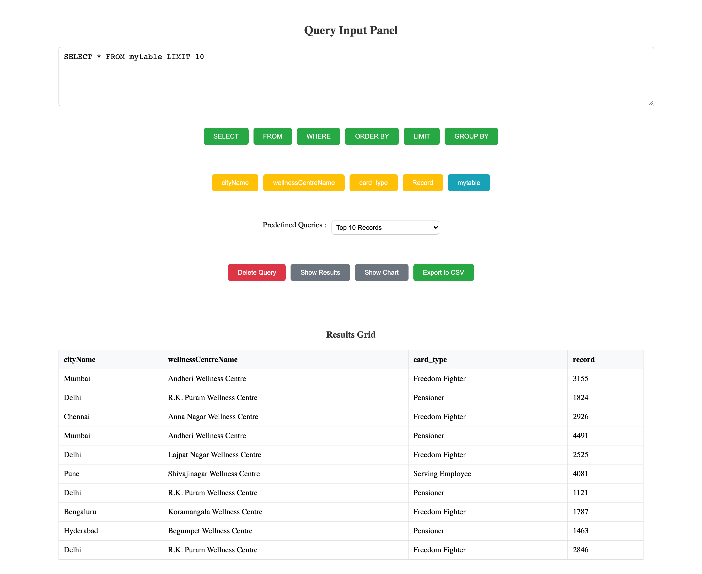
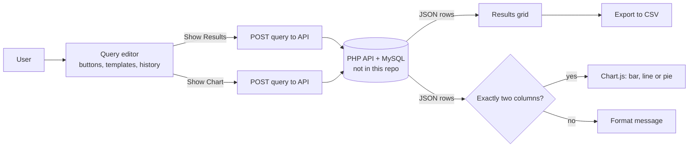
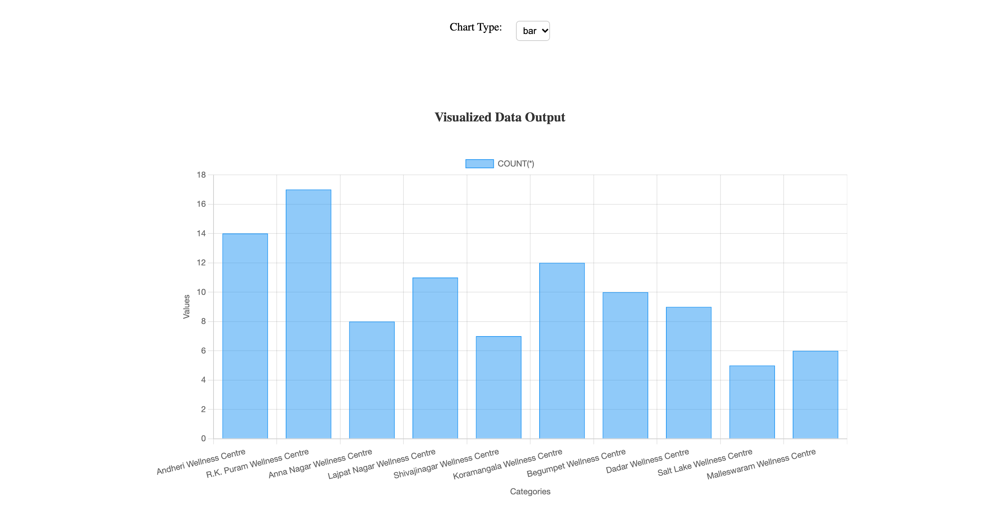
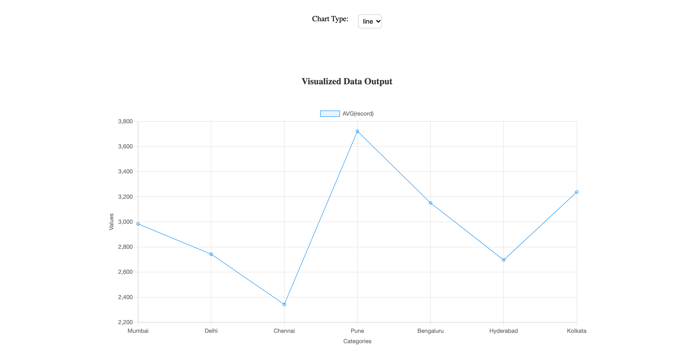
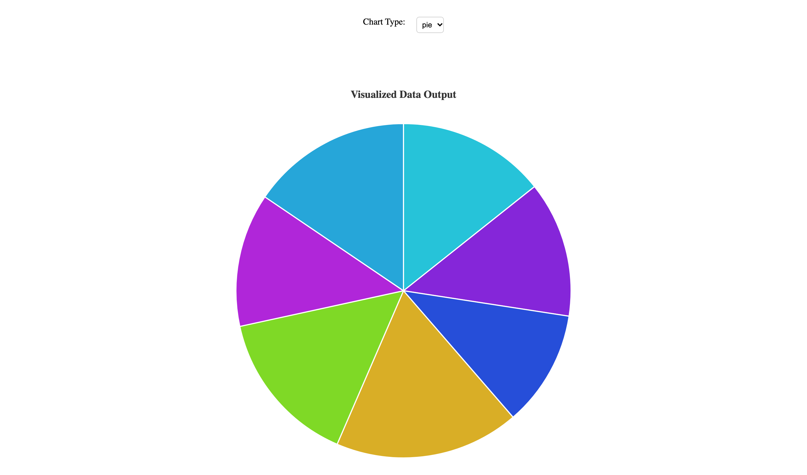
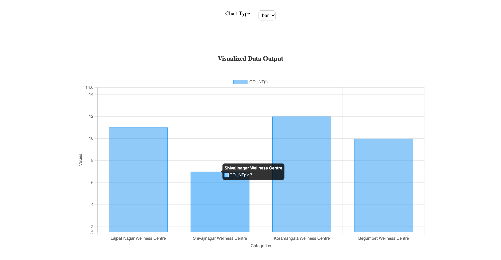
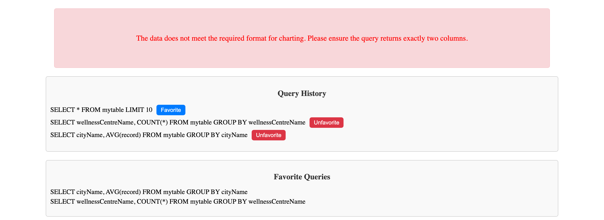

<div align="center">


# HubbleMind Visualization App

### Type a SQL query, see the answer as a table or a chart

A single-page Angular app that sends SQL queries to a PHP/MySQL API<br>
and shows the rows as a results grid or as a bar, line or pie chart you can zoom and pan.


-777bb4)

**[Live demo](https://dynamic-data-visualization-platform.vercel.app)** &nbsp;·&nbsp; [How it works](#how-it-works) &nbsp;·&nbsp; [Features](#features) &nbsp;·&nbsp; [Screenshots](#screenshots) &nbsp;·&nbsp; [Get started](#get-started) &nbsp;·&nbsp; [Reference](#reference)

</div>

---

## What is HubbleMind?

**Why.** Data in a MySQL table is easy to query and hard to look at. A list of rows answers "what is in there", but a
question like "which wellness centre has the most records" or "how does the average differ by city" is answered faster
by a chart. Opening a separate BI tool for each of those questions is a lot of ceremony.

**What.** HubbleMind is a small web front end for exactly that loop. You write a SQL query (by hand, with keyword and
column buttons, or from a list of ready-made templates), and the app posts it to a PHP/MySQL API. The JSON rows come
back as a results grid you can export to CSV, or as a bar, line or pie chart. Queries you run are kept in a history
list, and you can mark the ones you reuse as favourites.

**Result.** One page, one text box, three chart types. Any query that returns two columns (a label and a number) can be
drawn, and bar and line charts can be zoomed with the mouse wheel or a pinch and panned by dragging.

<p align="center">
  
</p>

<sub>The query panel after running the "Top 10 Records" template. Rows come from a mocked API response with demo data shaped like the `mytable` columns used in the app (`cityName`, `wellnessCentreName`, `card_type`, `record`).</sub>

## Features

| Feature | What it does | Where |
|---|---|---|
| Query editor | Free-text SQL in a textarea | `home.component.html` |
| Keyword buttons | Append `SELECT`, `FROM`, `WHERE`, `ORDER BY`, `LIMIT`, `GROUP BY`, tidying trailing commas | `appendToQuery()` |
| Column buttons | Append `cityName`, `wellnessCentreName`, `card_type`, `record` and the table name `mytable` | `appendToQuery()` |
| Predefined queries | Six templates: Select All, Count Records, Group by wellnessCentreName, Top 10 Records, Average Record by City, Records with Specific Card Type | `queryTemplates` |
| Results grid | Renders any JSON array of rows as a table, columns taken from the first row's keys | `showTable()` |
| Charts | Bar, line or pie from a two-column result: first column = labels, second = values | `showChart()`, `updateChart()` |
| Zoom and pan | Mouse-wheel and pinch zoom, drag to pan, on bar and line charts (`chartjs-plugin-zoom`, both axes) | `barChartOptions` |
| Shape check | If a chart query does not return exactly two columns, a message explains why instead of drawing a broken chart | `updateChart()` |
| CSV export | Downloads the current results grid as `QueryResults_export_<timestamp>.csv` | `ExportService` |
| Query history | Every distinct query you run is listed; click one to load it back into the editor | `saveQueryToHistory()` |
| Favourites | Toggle Favorite / Unfavorite on a history entry; favourites get their own list | `markAsFavorite()` |
| Reset | "Delete Query" clears the query, the grid, the chart and the chart settings | `DeleteQuery()` |

History and favourites live in component memory, so they reset when the page is reloaded.

## How it works

<!-- diagram:flow -->

<!-- /diagram -->

<sub>API = the separate PHP service that runs the SQL against MySQL and returns the rows as JSON; JSON rows = an array of objects, one per row, keyed by column name; Chart.js = the charting library, used here through the ng2-charts Angular wrapper.</sub>

1. **Write a query.** Type it, build it with the keyword and column buttons, pick a template, or click an earlier query in the history.
2. **Send it.** "Show Results" and "Show Chart" both save the query to the history and `POST { "query": "..." }` to the API URL set in `HomeComponent`.
3. **Read the rows.** The API answers with a JSON array of row objects. On an HTTP error the app shows an alert: *SQL Query is Required / Not Valid*.
4. **See a table.** "Show Results" renders the rows in the results grid, and "Export to CSV" saves them to a file.
5. **See a chart.** "Show Chart" uses the first column as labels and the second as values. The Chart Type dropdown switches between bar, line and pie and redraws at once.
6. **Explore it.** On bar and line charts, scroll or pinch to zoom and drag to pan. Pie slices get random colours, with tooltips on hover.

**Tech stack:** Angular 19.1 with standalone components and TypeScript 5.7, Chart.js 4.4 through ng2-charts 8,
chartjs-plugin-zoom 2.2 (with hammerjs for touch gestures), RxJS `HttpClient` for the API calls, Tailwind CSS 4 wired
in through PostCSS (the current screens use plain component CSS), Vercel Speed Insights, and Karma with Jasmine for unit
tests. The PHP/MySQL API is a separate project and is not part of this repository.

## Screenshots

<table>
  <tr>
    <td width="50%"></td>
    <td width="50%"></td>
  </tr>
  <tr>
    <td><sub><b>Bar chart.</b> "Group by wellnessCentreName": one bar per centre, height = <code>COUNT(*)</code>.</sub></td>
    <td><sub><b>Line chart.</b> "Average Record by City" with the Chart Type set to <code>line</code>.</sub></td>
  </tr>
  <tr>
    <td></td>
    <td></td>
  </tr>
  <tr>
    <td><sub><b>Pie chart.</b> The same city averages as a pie. Slice colours are random and the legend is hidden; hover a slice for its label and value.</sub></td>
    <td><sub><b>Zoom and pan.</b> The bar chart after a few mouse-wheel steps: both axes rescale to four centres, with a hover tooltip.</sub></td>
  </tr>
  <tr>
    <td colspan="2"></td>
  </tr>
  <tr>
    <td colspan="2"><sub><b>History, favourites and the shape check.</b> Charting a four-column query shows the format message instead of a chart. Below it, every query run so far, two of them marked as favourites.</sub></td>
  </tr>
</table>

<sub>All screenshots were taken from a local `ng serve` build with the API calls answered by mocked JSON (demo wellness-centre data, no real records).</sub>

## Get started

You need npm and a Node.js version supported by Angular 19 (18.19+, 20.11+ or 22+).

```sh
npm install
npm start              # ng serve: dev server on http://localhost:4200/, reloads on file changes
npx ng build           # production build into dist/projet-no-ssr/
npx ng test            # unit tests with Karma (Jasmine)
```

To see data, the app needs the PHP/MySQL API. Set its full address in `src/app/home/home.component.ts` (see
[API contract](#reference) below). The [live demo](https://dynamic-data-visualization-platform.vercel.app) shows the
interface; with the API address as currently committed, its queries go to the demo's own host and return no rows.

```text
src/
  main.ts                         bootstraps the app and injects Vercel Speed Insights
  index.html, styles.css          page shell and global styles
  app/
    app.component.*               root component, renders <app-home>
    app.config.ts, app.routes.ts  providers and (empty) route table
    home/home.component.*         the whole UI: editor, templates, grid, charts, history, favourites
    services/export.service.ts    CSV export
angular.json                      Angular CLI project "projet-no-ssr"
.postcssrc.json                   PostCSS config with the Tailwind 4 plugin
```

## Reference

<details>
<summary><b>API contract</b></summary>

The front end makes a single kind of request. Both buttons send the same body:

```http
POST <URL>
Content-Type: application/json

{ "query": "SELECT cityName, AVG(record) FROM mytable GROUP BY cityName" }
```

Expected response: a JSON array of row objects, one key per column.

```json
[
  { "cityName": "Mumbai", "AVG(record)": "2984.3913" },
  { "cityName": "Delhi",  "AVG(record)": "2743.1071" }
]
```

| Used by | Needs |
|---|---|
| Results grid | Any number of columns; headers come from the keys of the first row |
| Charts | Exactly two columns; first = label (x axis / slice), second = numeric value |
| Error handling | Any non-2xx status shows the alert *Error: SQL Query is Required / Not Valid !* |

The API address is the `URL` field of `HomeComponent` (`src/app/home/home.component.ts`). In the repository it is set to
`database-api-php.free.nf`, without `http://` or `https://`, so the browser resolves it as a path on the app's own host
(for example `https://<app-host>/database-api-php.free.nf`). Use the API's full URL, including the scheme, when you
point the app at your backend.

The app sends whatever SQL the user types. Restricting what may run (read-only user, allowed tables, statement checks)
is the API's job.

</details>

<details>
<summary><b>Built-in query templates</b></summary>

| Template | Query |
|---|---|
| Select All | `SELECT * FROM mytable` |
| Count Records | `SELECT COUNT(*) FROM mytable` |
| Group by wellnessCentreName | `SELECT wellnessCentreName, COUNT(*) FROM mytable GROUP BY wellnessCentreName` |
| Top 10 Records | `SELECT * FROM mytable LIMIT 10` |
| Average Record by City | `SELECT cityName, AVG(record) FROM mytable GROUP BY cityName` |
| Records with Specific Card Type | `SELECT cityName, wellnessCentreName, record FROM mytable WHERE card_type = 'Freedom Fighter'` |

Templates, column buttons and the table name are defined in `home.component.ts` and `home.component.html`; change them
there to point the app at a different table.

</details>

<details>
<summary><b>Charts and zoom settings</b></summary>

- Chart types: `bar`, `line`, `pie` (`chartTypes`). The default is `bar`, and "Delete Query" resets it to `bar`.
- Bar and line: category x axis titled "Categories", linear y axis titled "Values", dataset label = name of the second column.
- Zoom (`chartjs-plugin-zoom`): `wheel` and `pinch` enabled, `mode: 'xy'`; pan enabled, `mode: 'xy'`. The plugin is registered in the `HomeComponent` constructor.
- Pie: one random HSL colour per slice, white borders, legend hidden, tooltips on. Zoom is not configured for pie.
- The chart area is a fixed 1000 × 600 px box.

</details>

<details>
<summary><b>CSV export</b></summary>

`ExportService.exportToCSV()` writes a header line from the keys of the first row, then one line per row with values
joined by commas, and downloads it as `QueryResults_export_<epoch ms>.csv`. Values are not quoted, so fields that
contain commas will split into extra columns.

</details>

<details>
<summary><b>Angular CLI and tests</b></summary>

The project was created with the Angular CLI and is named `projet-no-ssr` in `angular.json` and `package.json`.

```sh
npx ng generate component component-name   # also directive|pipe|service|class|guard|interface|enum|module
npx ng build --watch --configuration development   # same as: npm run watch
npx ng help
```

Unit tests: three spec files (`app.component.spec.ts`, `home.component.spec.ts`, `export.service.spec.ts`) with five
tests. Four pass. The CLI-generated `AppComponent should render title` test still expects a `Hello, projet-no-ssr`
heading that the app no longer renders, so it fails. No end-to-end test runner is configured.

The production build warns that the initial bundle (about 556 kB) is over the 500 kB budget set in `angular.json`, and
that `home.component.css` is over the 2 kB component-style budget. Both are warnings, not errors.

</details>

---

<sub>This README and its screenshots were produced with an AI coding assistant; every feature listed here was checked against the source in `src/`.</sub>
